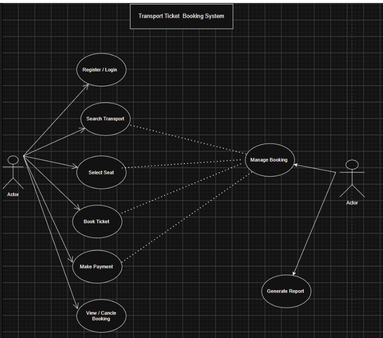
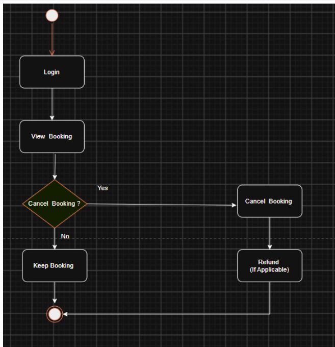
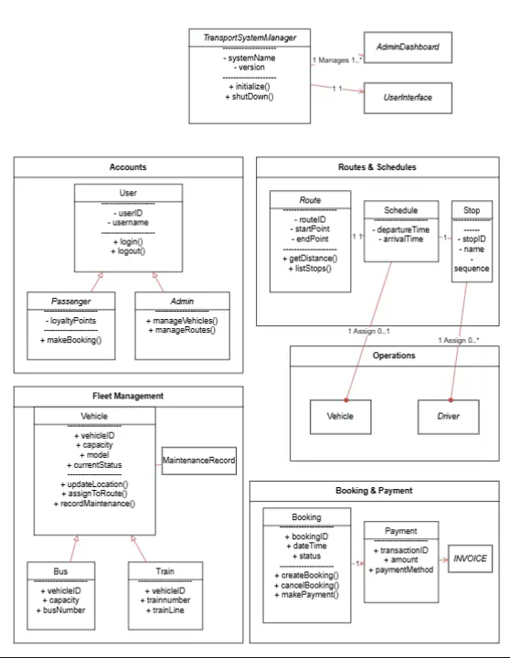
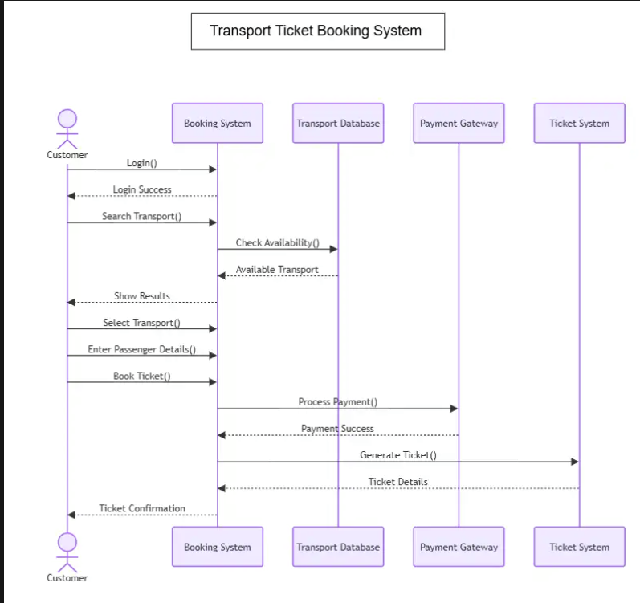
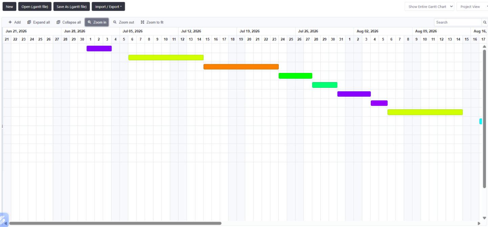

# Transport Ticket Booking System

## Project Overview
The Transport Ticket Booking System is a web-based project designed to help users search transport routes, check availability, book tickets, and manage bookings.

## UML Diagrams

### 1. Use Case Diagram

### 2. Activity Diagram 1

### 3. Activity Diagram 2

### 4. Activity Diagram 3

### 5. Class Diagram

### 6. Sequence Diagram

### 7. Gantt Chart

## Cost Estimation
The project cost estimation is implemented using the COCOMO model in Python.

## Technologies Used
- UML
- Git and GitHub
- Python
- Project Management Tools

## Author
Anushka Pande
